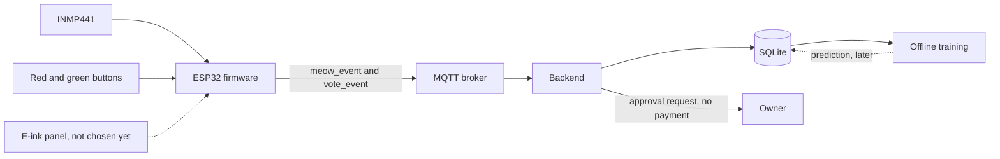

# meowmap

**Status: early prototype / work in progress.**

meowmap is an open-source project to classify a cat's meows — hunger, drama, or attention — from a microphone by the food bowl, and to let the cat vote on food with two arcade buttons and an e-ink screen. Each captured clip and each button press is stored so they can become the start of an open meow dataset. When a later model is confident a meow is hunger and the green votes agree on a food, a backend drafts an order and asks the owner to approve it. It never pays on its own.

This repository is that starting point and nothing more. There is no trained model, no accuracy number, and no hardware bring-up. The firmware is written to compile. It has not been flashed for this scaffold. The learning code refuses to invent a score when the dataset is empty.

## How the pieces are meant to fit

One ESP32 is the whole first device: the bowl mic, the two buttons, and, later, an e-ink panel. A second board for the booth can wait.



The dotted edges are not built. Training runs off the device. The ESP32 does not classify meows.

## Hardware

| Part | Role | Starting pin |
| --- | --- | --- |
| ESP32 dev module | Controller, Wi-Fi, MQTT | — |
| INMP441 | I2S microphone at the bowl | BCLK GPIO 14, WS GPIO 27, data GPIO 32. Tie L/R to GND so the mic is the left channel. |
| Green arcade button | Yes to the food on screen | GPIO 13 to GND, internal pull-up |
| Red arcade button | No | GPIO 21 to GND, internal pull-up |
| E-ink panel | Show the current food option | Not chosen. No driver in this tree. SPI pins 5, 18, 19, and 23 are left free. |

The INMP441 is a 3.3 V part. Do not power it from 5 V.

Pins are a concrete map so the firmware has something to build. They have not been checked with a meter or a scope. Button contacts are debounced in software (40 ms) and a press is the falling edge only, so holding the button does not repeat.

Until a panel exists, every vote is published with `option.source = "none"` and `option.option_id = "unassigned"`. The press is stored. It is not a food label yet.

## Audio

Clips are fixed:

- 16 kHz
- mono
- signed 16-bit little-endian PCM
- 2.0 seconds, which is 32,000 samples and 64,000 bytes

On the wire the bytes are raw PCM, base64, split across MQTT messages. A full clip is about 85 KB of base64, which is an uncomfortable single payload for the ESP32 client, so firmware 0.1.0 sends a header and then 134 slices of 480 raw bytes (the last slice is 160). On disk, the dataset uses WAV files with the same PCM so a clip opens in a normal editor. The loader rejects any other rate, channel count, width, or length. It does not resample.

The INMP441 clocks out 24-bit samples in a 32-bit I2S slot. The firmware keeps the top 16 bits (`>> 16`). That shift is a guess. `detector.calibrated` is `false` in schema 0.1.0 and the schema will not accept `true`.

The on-device trigger is an energy gate, not a cat detector. It opens when the RMS of 20 ms frames stays at or above a placeholder threshold of 800 (int16 scale, not dBFS) for 3 frames. A short ring keeps 160 ms before the trigger, then the clip runs until it is 2 seconds long. Quiet audio is not stored. Loud audio that is not a meow still is, which is why `not_cat` is a class.

## Noise plan

Three separate ideas, none of them demonstrated on cat audio:

1. **Energy gate on the device**, described above. It drops silence. It does not know what a meow is. The threshold is a named constant in `firmware/include/config.h`.
2. **Bandpass before features**, 200 Hz to 7 kHz, Butterworth order 4, then a 40-band log-mel (25 ms window, 10 ms hop, 512-point FFT). Those edges are a starting filter for rumble and some hiss, not a measured meow band. The implementation is local and is not a librosa clone.
3. **A `not_cat` class** in the label set, for fridge noise, speech, kibble, dogs, and the button click. Collecting it is future work. There is no rejector in this repo.

## Dataset plan

Classes, and the folder each one lives in:

- `hunger`
- `drama`
- `attention`
- `not_cat`

The collection goal to start is about **200 clips per class**, from more than one cat if that is possible. Two hundred is a gathering target. It is not a sample size that guarantees a useful model, and this repo will not publish a number from a smaller set as the project's accuracy.

Labels for those classes come from a person. A red or green press is a food vote: yes or no to whatever the screen was showing. It is not a hunger, drama, or attention label. The two problems share a device and a schema, and they stay distinct on purpose.

```
ml/data/raw/hunger/
ml/data/raw/drama/
ml/data/raw/attention/
ml/data/raw/not_cat/
```

WAV only, matching the spec above. The training script will not write a model until every class has at least 4 clips, and even then the report says the artifact is not publishable. Four is only there to avoid fitting a single example. `--smoke-test` synthesizes tones, not meows, and labels the output the same way.

## Repository layout

```
schema.json                  shared meow_event and vote_event contract
examples/                    shape examples, not recordings
firmware/                    PlatformIO project, Arduino framework, ESP32
  include/config.h           pins, audio sizes, untuned energy threshold
  include/secrets.example.h  Wi-Fi and MQTT placeholders
  src/                       I2S capture, energy gate, buttons, MQTT
ml/
  meowmap_ml/                log-mel, dataset loader, train, TFLite export
  data/raw/                  empty class folders
backend/
  meowmap_backend/           MQTT subscriber, SQLite, approval rule
```

## Shared events

`schema.json` is draft **0.1.0**. Firmware, the backend, and any later label tool should send documents that validate against it.

MQTT topics, unless `secrets.h` or the backend environment overrides them:

- `meowmap/events/meow` — a header (`message_role: header`) or one audio slice (`audio_chunk`)
- `meowmap/events/vote` — one red or green press

A meow header may later carry a `prediction` object. The firmware does not send one. Nothing here produces a real prediction.

`examples/` holds one header, one audio slice of silence, and one vote with no food on screen. They are shape samples.

## Workstreams

The prototype is split into three workstreams that can move in parallel, and the plan is to build them with Devin:

1. **Firmware** — mic, buttons, MQTT, and eventually the e-ink panel.
2. **ML** — the dataset, features, a small model, and a TFLite export.
3. **Backend** — ingest, the approval rule, and later a real text to the owner.

They share `schema.json` and the audio spec. This tree is the shared scaffold. No workstream has a finished result in it.

## Firmware

```bash
cd firmware
cp include/secrets.example.h include/secrets.h   # then edit; secrets.h is gitignored
pio run
```

`pio run` compiles the ESP32 image. It does not flash a board. Without `secrets.h` the build uses the example placeholders, which point MQTT at `127.0.0.1`.

What the code does: install the I2S driver for an INMP441, keep a 2 second clip when the energy gate opens, debounce the two buttons, and publish schema-shaped JSON over Wi-Fi MQTT once SNTP has set the clock. The clip's SHA-256 is on the header. What it does not do: classify audio, drive a display, or claim the clock rate and the `>> 16` shift are right. Both need a board.

PlatformIO is pinned to `espressif32` 5.4.0. That pin resolves to Arduino-ESP32 2.0.6, whose legacy `driver/i2s.h` API is what this source talks to.

## Learning

From `ml/`, with the packages in `requirements.txt`:

```bash
python -m unittest discover -s tests -v
python -m meowmap_ml.train --smoke-test --out /tmp/meowmap-smoke
python -m meowmap_ml.export_tflite --smoke-test --out /tmp/meowmap-tflite
```

The first command checks the feature shape and that an empty dataset does not produce a model. The smoke commands fit a logistic regression, and a four-filter CNN exported to TensorFlow Lite, on synthetic tones. Their reports set `synthetic: true` and `publishable: false`. The TFLite file is an export-path check. It is not a meow classifier and it has not been run on an ESP32.

A real run looks at `data/raw/<class>/*.wav` and exits without a model while any class is short of 4 clips.

## Backend

From `backend/`, with the packages in `requirements.txt`:

```bash
python -m unittest discover -s tests -v
python -m meowmap_backend decide --sqlite /tmp/meowmap.db
python -m meowmap_backend serve
```

`serve` subscribes to the two topics and stores valid events in SQLite. Invalid JSON is logged and dropped. Audio slices for one `event_id` can be reassembled and checked against the header SHA-256.

`decide` runs the ordering rule once. The rule creates a row only when all of these hold:

- a meow header already has `prediction.label = hunger` and `confidence` at or above **0.85**
- at least **2** green votes for the same device fall inside **30 minutes** of that meow
- those votes name one real food (`option.source` is `eink` or `manual`, with a label)

The numbers are placeholders. They were not tuned. Votes with `source: none` do not count, so a board running this firmware cannot trip an order. A tie between two foods creates nothing. The same green votes are only spent once.

The row is `pending_approval`, `payment_status` is `not_attempted`, and `dispatched_at` is null. SQLite checks reject any other payment status and any non-null send time. There is no SMS provider and no payment provider. The message text says it was not sent and that no payment was made.

Configuration is environment variables, listed in `backend/.env.example`. A local `backend/.env` fills only keys that are not already set. Passwords are not command-line arguments.

## Roadmap

Nothing below is done. The boxes are the plan.

### Firmware

- [ ] Confirm the INMP441 wiring on a board and capture a known tone
- [ ] Check the I2S bit clock and the `>> 16` conversion against that tone
- [ ] Retune the energy threshold in the room where the bowl sits
- [ ] Choose an e-ink panel and draw the current food option
- [ ] Publish a clip and a vote to a broker and validate both against `schema.json`
- [ ] Lengthen the 160 ms pre-roll if real meows are still clipped at the start

### ML

- [ ] Collect about 200 clips for each of hunger, drama, attention, and not_cat
- [ ] Write the labeling guide a person uses for those classes
- [ ] Run the bandpass and log-mel path on those clips
- [ ] Train only after that set exists, and publish a score with the frozen split it came from
- [ ] Export a TFLite model small enough for the ESP32, then measure it on device

### Backend

- [ ] Run a broker with TLS and put real host settings in `secrets.h`, not in git
- [ ] Reassemble chunked audio into WAV files a person can label
- [ ] Revisit the hunger threshold and the green-vote count after real predictions exist
- [ ] Send the approval text with a real SMS provider, still without paying
- [ ] Add an owner approval that expires. Payment stays out of scope until that exists

## License

MIT. See [LICENSE](LICENSE).
